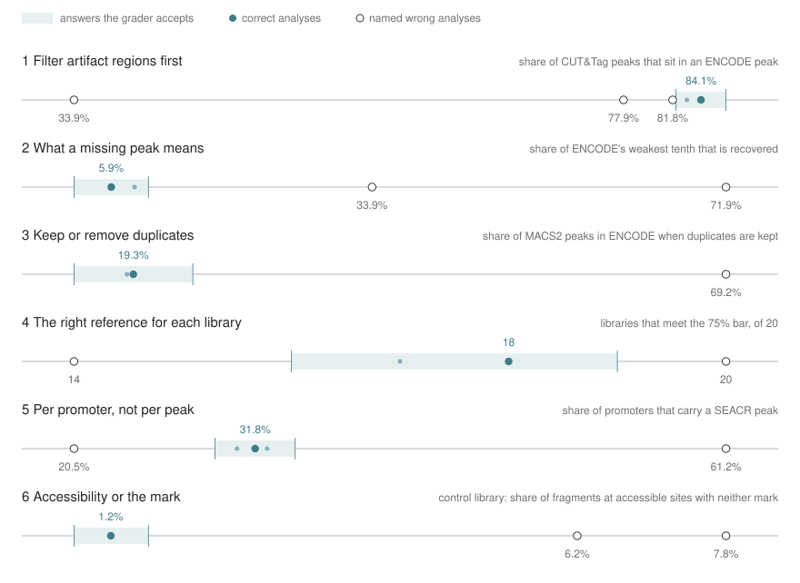

# epigenomics-evals

[](https://github.com/di-omics/epigenomics-evals/actions/workflows/ci.yml)

**Epigenomics evaluation tasks for AI agents, built from one published CUT&Tag
paper.**

- Built by a co-first author of the paper.
- 6 example tasks in LatchBio's public eval format, each shipped with the
  scripted controls its grader was tested against, and one pilot that replays
  with a single command.
- Independent work. Not affiliated with LatchBio, and not part of EpiBench.
- Written and checked by AI models under the author's direction. No person has
  reviewed the controls or the answer keys yet.

The paper is Abbasova, Urbanaviciute, Hu et al., "CUT&Tag recovers up to half
of ENCODE ChIP-seq histone acetylation peaks", Nature Communications 2025
([doi:10.1038/s41467-025-58137-2](https://doi.org/10.1038/s41467-025-58137-2)).
It benchmarks CUT&Tag against ENCODE ChIP-seq in K562 cells and works through
the decisions an analyst has to make along the way: which peaks to trust,
whether to keep duplicates, which peak caller, what a missing peak means.

Each of those decisions is a place where a competent-looking analysis can go
wrong without any error message. A task here takes one decision from the
paper, gives an agent the files a scientist had at that point, and asks a
question whose answer can be checked.

## Why the controls

A grader accepts a range of answers. Whether that range means anything depends
on what falls inside it and what falls outside. So before a task is accepted
into this repository, 3 kinds of analysis are scripted and graded:

- **reference**: the analysis the task is built around. Must pass.
- **variant**: a defensible alternative, such as another coordinate convention
  or a lighter filter. Must pass. The tolerance is set so that it does.
- **trap**: a plausible wrong analysis, named in the task notes. Must fail.

This is the habit of assay development applied to benchmark writing: a readout
is not trusted until its positive and negative controls have been shown to
separate. Each task isolates one decision. Differences that are not the point
of a task are absorbed by its tolerance and listed as variants.

## The tasks and what the controls show

<picture>
  <source media="(prefers-color-scheme: dark)" srcset="docs/controls-dark.svg">
  
</picture>

One number per task is drawn here. Each task grades several, and some wrong
analyses fail on a decision instead of a number: the full table is in
[results/CONTROLS.md](results/CONTROLS.md).

<!-- BEGIN GENERATED -->
| Task | From the paper | The correct analysis finds | The wrong analysis the grader rejects | Decision key |
|---|---|---|---|---|
| `ct01_encode_capture` | Fig. 5b (precision and recall of ENCODE capture); Methods, peak filtering | 19,672 peaks, 84.1% in ENCODE, 33.9% of ENCODE recovered | file as delivered: 21,487 peaks, 77.9% in ENCODE | none: numbers only |
| `ct02_strong_vs_weak_recovery` | Fig. 5c (ENCODE q-values of captured and missed peaks) | 89.4% of the strongest tenth of ENCODE recovered, 5.9% of the weakest tenth | one overall figure (33.9%), and a missing peak read as a missing mark | awaits review by a person |
| `ct03_duplicates_decision` | Fig. 5b, Supplementary Fig. 3e and 5a (duplicates, by peak caller) | MACS2 peaks in ENCODE: 84.1% without duplicates, 19.3% with; SEACR 92.3% and 92.6% | judged on ENCODE recovered instead (33.9% to 69.2%), so duplicates are kept | awaits review by a person |
| `ct04_antibody_panel_reference` | Fig. 2e and Supplementary Fig. 1f (PCR cycles and DNA extraction, matched depth) | 18 of 20 libraries meet the bar; lowest 69.9% | one reference for all: 14 of 20; lowest 0.2% | none: numbers only |
| `ct05_promoter_denominator` | Fig. 6a and Supplementary Fig. 6c-e (promoter overlap by peak caller) | promoters with a peak: MACS2 33.9%, SEACR 31.8% | share of peaks at promoters: MACS2 50.1%, SEACR 61.2% | awaits review by a person |
| `ct06_open_chromatin_control` | Fig. 3c and the short-fragment analysis in Results (open chromatin bias) | control library at unmarked accessible sites: 1.2% of fragments; H3K27ac library at marked accessible sites: 23.8% | H3K27me3 domains ignored: control reads 6.2% | awaits review by a person |

4 tasks end in a multiple-choice decision: `ct02_strong_vs_weak_recovery`, `ct03_duplicates_decision`, `ct05_promoter_denominator`, `ct06_open_chromatin_control`. Those keys were checked against the data by script and have not been reviewed by a person. 5 of the wrong analyses fail on that decision alone, so their verdicts depend on those keys.

Controls: 6 tasks, 43 scripted analyses (25 that should pass, 18 that should fail). 43 of 43 behave as expected. Graded twice, with this repository's own window check and with latch-eval-tools 0.4.54; the two agree on every one. All of these checks were designed and run by AI models; no person has checked the controls, the windows or the keys yet. Full table: [results/CONTROLS.md](results/CONTROLS.md).

Anchors to the paper, recomputed from its public files:

| The paper says | Recomputed here |
|---|---|
| Average ENCODE recall of 54% across CUT&Tag experiments (sd 4.99) (Abstract; Results, Fig. 5b) | 53.2% (sd 6.09) over the 6 H3K27ac benchmarking libraries x 2 peak callers in GEO |
| Antibody ab177178 did not reach 75% precision with MACS2 (Results, Fig. 4a) | MACS2 precision 63.1% and 64.6% for the 2 ab177178 libraries |
| Nearly 70% of ENCODE H3K27ac peaks overlapped with ATAC-seq peaks (Results, Fig. 3c) | 69.4% |
| An average of 1.35 to 1.68 MACS2 peaks overlapping a SEACR peak per sample (Results, peak calling) | 1.41 for the library used in the tasks |
| Duplication rates between 55.49% and 98.45% across samples (Results; Supplementary Table 2) | 96.36% for the library used in the tasks |
| About 8% of H3K27me3 CUT&Tag reads fell into ATAC peaks (8.29%), 5.88% after removing fragments under 100 bp (Results, Fig. 3c) | 7.84% and 6.54% on the first-round H3K27me3 library in the code repository (the paper's figures are for 2 later libraries) |
<!-- END GENERATED -->

Prompts, answer keys, windows and notes in readable form:
[docs/TASKS.md](docs/TASKS.md).

## A runnable pilot

[pilot/](pilot/README.md) is one more task, built to be checked end to end
without a model: the peak-set choice from Figure 4a of the paper, with blinded
inputs, an answer schema, a deterministic grader and scripted replays. It
ships its inputs, so it needs no download:

```bash
python3 pilot/replay.py
```

It is an independent prototype in the style of LatchBio's EpiBench, not part
of it.

## Format

Every `evals/<id>/eval.json` uses the 7 keys of LatchBio's public scBench
examples: `id`, `canary`, `task`, `data_node`, `grader`, `metadata`, `notes`.
EpiBench's public examples carry 5 of those (no `grader`, no `notes`), and the
pilot's `eval.json` follows that shorter form.

- These 6 are public example tasks. Their answer keys and notes are published
  here, as scBench publishes them for its canonical examples, and each task
  carries a canary string.
- `task` ends in an `<EVAL_ANSWER>` block naming the JSON fields to return.
- `grader` uses grader types from the published `latch-eval-tools` package:
  `numeric_tolerance`, and `all_of` where a task also asks for a decision.
- A decision is an option number graded as an exact number. The package's
  `multiple_choice` grader reads a field called `answer`, and these tasks name
  their decision field for what it decides. The pilot, whose field is called
  `answer`, uses `multiple_choice`.
- `notes` follows the structure of the scBench notes: scientific intent, the
  primary trap, accepted analyses with measured values, wrong analyses with
  measured values and how far outside the window they land, the tolerance
  rationale, the data, and what the prompt does not say. Two more sections
  give the evidence behind each decision key and its review status.
- `metadata.kit` is `hts`, the value LatchBio uses for its public CUT&RUN
  example. `metadata.failure_modes` reuses label strings that appear in
  LatchBio's public eval metadata. The mapping to these tasks is ours; we did
  not find public definitions for the labels.
- `data_node` is null, because the files are not on Latch. `data_files` lists
  each input with its public source and SHA-256 instead.

## Reproduce

```bash
uv venv --python 3.12 .venv
uv pip install --python .venv/bin/python -e ".[grade,dev]"
.venv/bin/python scripts/fetch_data.py           # about 280 MB from public sources
.venv/bin/python -m epigenomics_evals.build      # rebuilds evals/, results/, docs/
.venv/bin/python -m pytest
```

The build computes every answer key, every window and every measured value,
including the figures quoted in the task notes. The answer options are fixed
text; the build stops if a quantity they state does not hold in the data, or if
the keyed option is the longest or the shortest of its set.

To try a task yourself, or hand it to an agent:

```bash
.venv/bin/python scripts/stage_task.py ct03_duplicates_decision /tmp/ct03
```

That makes a folder with the task's input files and `task.md`, and nothing
else: no answer key, no notes.

## Limits

- **No agent has been run on the 6 tasks.** There are no model results for
  them. The controls show that each grader separates the analyses we scripted.
  They do not show that an agent makes those mistakes, and they cannot show
  that no other mistake slips through. The pilot has its own short record of
  agent runs, described in its README.
- **The decision keys have not been reviewed by a person.** The tasks that end
  in a multiple-choice decision are named above. Their keys were checked
  against the data by script (notes, sections 9 and 10). The traps that fail on
  the decision alone depend on those keys.
- **`ct06_open_chromatin_control` goes beyond the paper.** The paper splits
  accessible sites by H3K27ac and reports the share of H3K27me3 reads in ATAC
  peaks. Reading the H3K27me3 library as a control at specific classes of site
  is this repository's own analysis of the paper's public files, and a
  chromatin biologist may disagree with its key. It is first in line for the
  author's review.
- **One library carries 5 of the 6 tasks.** It is the first-round library that
  the paper's code repository ships as its worked example, with a very high
  duplication rate. Its numbers are lower than the paper's headline figures,
  which come from 6 later libraries. On those, the reference code comes close
  to the published figures without matching them exactly (the anchors table
  has both).
- **Not affiliated with LatchBio and not part of EpiBench.** Compatible means
  the grader blocks run under `latch-eval-tools` 0.4.54 and the JSON uses the
  same keys. The tasks have not been run in Latch's harness.
- **The answer keys are public.** Each task carries a canary string. Do not
  train on this repository.

## Data and licenses

Code: MIT, see [LICENSE](LICENSE). Each data source keeps its own terms; they
are listed with attributions in [THIRD_PARTY_NOTICES.md](THIRD_PARTY_NOTICES.md).

The input data of the 6 tasks is not stored in this repository:
`scripts/fetch_data.py` downloads it and verifies every file against
`scripts/data.sha256`. The pilot is the exception. It ships its own inputs
(about 5 MB of 3-column peak files derived from the sources below) so that it
runs without a download.

- Peak files and fragment files: the paper's code repository,
  [Marzi-lab/CUTnTag-benchmarking-analysis](https://github.com/Marzi-lab/CUTnTag-benchmarking-analysis)
  (MIT), pinned to commit `52270f5`, and GEO
  [GSE286492](https://www.ncbi.nlm.nih.gov/geo/query/acc.cgi?acc=GSE286492).
- ENCODE K562 peak sets ENCFF044JNJ (H3K27ac) and ENCFF000BXB (H3K27me3), and
  ATAC-seq peaks that the paper's authors processed from ENCODE libraries.
  These are ENCODE data, used under ENCODE's terms, not under the MIT licence
  of the repository they were fetched from.
- The hg19 blacklist v2 (Boyle Lab, GPL-3.0), a RefSeq annotation and UCSC
  chromosome sizes are fetched for filtering and annotation. None of them is
  redistributed here, apart from a table of 24 chromosome lengths per build.
- `latch-eval-tools` is installed from PyPI as an optional dependency. None of
  its code is copied here.

## How it was built

The tasks, the code, the controls and these pages were written by AI coding
agents (Claude) under the author's direction. Every check reported here was
run by code in this repository and can be rerun with the commands above. No
person has checked the controls, the windows or the keys yet.
